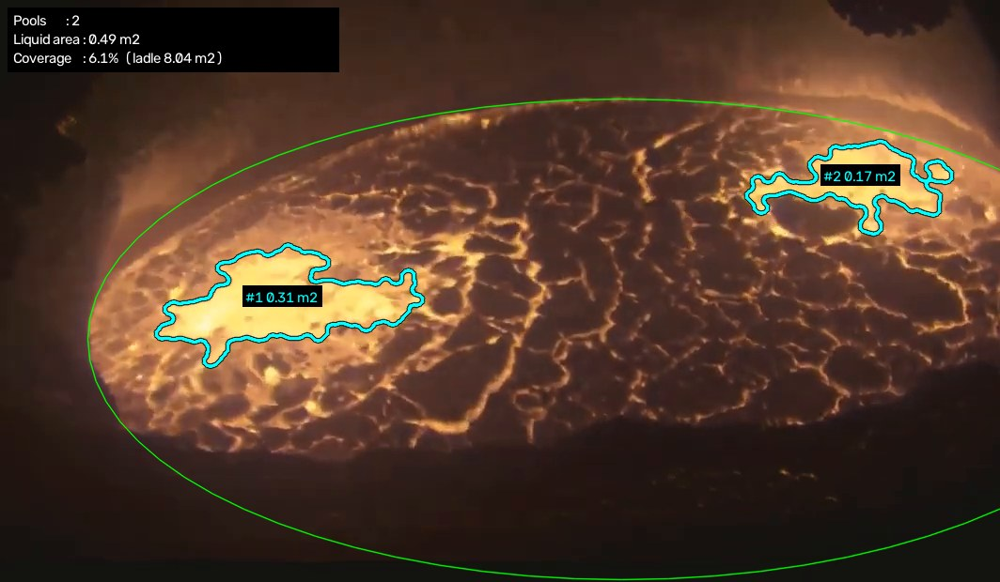

# Pota Sıvı Havuz Alanı Ölçümü

Sabit bir kameradan pota içinde adacıklar dışında kalan sıvı alanların gerçek zamanlı alanının hesaplanmasını sağlar.



## Program ne yapıyor?

Program bir kameradan potaya bakıyor ve parlak sarı sıvı kısımları buluyor. Her birinin etrafına çizgi çekip üstüne büyüklüğünü yazıyor.
Örnek bir video üzerinde denendi. Aynı program bir kameraya(USB ve IP kameralar) bağlanınca potayı canlı olarak izleyip ölçebilir şekilde hazırlandı.

USB kamera için:
```bash
python ladle_pool_area.py --src 0 --show
```
IP kamera için:
```bash
python ladle_pool_area.py --src rtsp://kameranin-adresi --show
```
- --src programa görüntüyü nereden alacağını söylüyor.
- --show görüntünün ekranda açılmasını sağlıyor.

## Gereksinimler

- Python 3.9+
- opencv-python
- numpy
- scipy

```bash
pip install opencv-python numpy scipy
```

## Canlı kamera ile ilk seferde yapılması gereken 3 ayar

Bunları sadece bir kez yapman yeterli.

1. Programa potayı tanıtmak (kalibrasyon)

Programın görüntüdeki pikselleri gerçek ölçüye çevirebilmesi için potanın yerini bilmesi gerekir.

- Ekranda pota görüntüsü açılıyor.
- Sen fareyle potanın kenarına 5–10 yerden tıklıyorsun.
- Program kenara yeşil bir halka çiziyor.
- Halka kenara oturduysa Enter’a basıyorsun.

Program artık potanın 3,2 metre olduğunu ve görüntüde nereye denk geldiğini biliyor. Böylece her şeyin gerçek büyüklüğünü hesaplayabiliyor.

```bash
python ladle_pool_area.py --src 0 --calibrate --show
```
2. Programın doğru yeri bulup bulmadığına bakmak

- Boyanan yerler gerçekten parlak sıvıysa: her şey yolunda. Program çalışırken klavyeden m tuşuna basınca, sıvı olarak algıladığı yerler renkli boyanır
- Sıvı kısımlar boyanmıyorsa: program fazla seçici; daha az parlak yerleri de kabul etmesi lazım.
- Kabuk aralarındaki ince parlak çizgiler de boyanıyorsa: program fazla gevşek; daha seçici olması lazım.

3. Kameranın otomatik parlaklık ayarını kapatmak

Program parlak yerleri sıvı olarak kabul ediyor. Kamera parlaklığı kendiliğinden değiştirirse sıvı olmayan yerler de parlak görünür ve ölçüm bozulur. Kamera ayarlarından "otomatik pozlama" (auto exposure) kapatılmalı.

## Hazır video için yapılması gerekenler

- Yeni videoyu programın bulunduğu klasöre kopyala.
- Adını basit bir şeyle değiştir, örneğin video2.mp4. Boşluk ve Türkçe karakter olmasın.
- Komutta video adını değiştir:

```bash
python ladle_pool_area.py --src video2.mp4 --show
```
Hazır video olan video.mp4 videosunun çıktısı docs klasöründe gösterilmiştir

[Videonun tamamını izle](docs/demo.mp4)

### Yeni videoda kalibrasyon

Programın içinde hazır duran ayar sadece ilk videoya göre yapıldı. O videoda potanın ekranda nerede ve ne büyüklükte durduğunu biliyor.
Yeni video başka bir açıdan, başka bir mesafeden ya da başka bir telefonla çekildiyse pota ekranda başka bir yerde olur. Kalibrasyon yapmazsan program eski yeri pota sanır ve sonuçlar yanlış çıkar.

Yeni videoyu ilk açışında şunu yaz:

```bash
python ladle_pool_area.py --src video2.mp4 --calibrate --show
```
Potanın kenarına tıkla, Enter’a bas. Ayar kaydedilir.
Ayar calibration.json adlı bir dosyaya kaydediliyor. Sonra eski videoya dönersen bu dosya yeni videoya göre kalmış olur. İki video arasında gidip gelirken her seferinde kalibrasyonu yenile, ya da calibration.json dosyasını silip eski videoyu açarken kalibrasyon yapmadan çalıştır.

Bunun için ekstra çalışma yapılabilir ancak bu sürümde kalibrasyon video başına elle yapılmaktadır.

**Farklı bir videoda ışık ve renkler farklı olabilir. Ekranda m tuşuna basıp boyanan yerlere bak:**

- Sıvı kısımlar boyanmıyorsa eşiği düşür: --threshold 160
- Kabuk aralarındaki çizgiler de boyanıyorsa çatlak ayarını artır: --crack 17

örnek:
```bash
python ladle_pool_area.py --src video2.mp4 --show --threshold 160
```
## Çalışma Prensibi
 
### 1. Piksel → alan dönüşümü
 
Kenar noktalarına doğrusal olmayan en küçük kareler yöntemiyle eksenleri yatay bir
elips uydurulur:
 
```
((x - cx) / a)² + ((y - cy) / b)² = 1
```
 
Görüntüdeki elipsin, potanın üstten görünen dairesel hâlinin dikey yönde basıklaşmış
bir görüntüsü olduğu varsayılır. Bu varsayımla elips yeniden daireye açıldığında
görüntünün her bölgesi aynı oranda büyür; bu nedenle tüm yüzey için tek bir alan
katsayısı kullanılabilir:
 
```
mm² / piksel = (D / 2)² / (a · b)
```
 
Referans kurulumda (a = 569 px, b = 256 px) bir piksel yaklaşık **17,6 mm²**'dir.
 
### 2. İlgi alanı (ROI)
 
Elips dolu bir maske olarak çizilir ve pota duvarındaki parlamayı dışarıda bırakmak
için 15 px içeri aşındırılır.
 
### 3. Ark eleme
 
ROI'nin %3'ünden fazlası doymuşsa ya da %1'inden fazlası parlak ve mavi baskınsa
kare atlanır. Ekranda son geçerli sonuç kalır.
 
### 4. Segmentasyon
 
| Adım | İşlem | Amaç |
|------|-------|------|
| Bulanıklaştırma | 7×7 Gauss | kıvılcım ve gürültüyü bastırmak |
| Eşikleme | gri > 175 | sıvıyı kabuktan ayırmak |
| Açma | 13 px elips çekirdek | ince parlak çatlakları silmek |
| Kapama | 9 px elips çekirdek | havuz içindeki küçük koyu benekleri doldurmak |
 
Referans videodaki tipik gri seviyeler:
 
| Bölge | Gri seviye |
|-------|-----------|
| Sıvı havuz | ~225 |
| Kabuk arası çatlaklar | 100–200 |
| Katı kabuk | ~65 |
 
Çatlaklar 5–8 px genişliğinde olduğundan açma işlemi onları siler, geniş havuzlar kalır.
 
### 5. Ölçüm
 
Havuzlar bağlı bileşen etiketleme (8-komşuluk) ile ayrılır. `--min-cm2` değerinden
küçük bileşenler atılır, çizim için dış konturlar çıkarılır ve her havuzun alanı
şöyle hesaplanır:
 
```
alan (m²) = piksel sayısı × mm²/piksel / 10⁶
```
 
Ekrandaki toplam değer son 8 karenin hareketli ortalamasıdır. Kaplama oranı, toplam
sıvı alanın pota alanına (π · 1,6² ≈ 8,04 m²) bölümüdür.
 
## Çıktı
 
CSV sütunları:
 
| Sütun | Açıklama |
|-------|----------|
| `frame` | kare numarası |
| `time_s` | saniye cinsinden zaman |
| `pools` | algılanan havuz sayısı |
| `area_m2` | toplam sıvı alan |
| `coverage` | sıvı alan / pota alanı |
| `arc` | kare atlandıysa 1 |
 
## Ayar
 
| Belirti | Çözüm |
|---------|-------|
| Havuzlar eksik ya da küçük | `--threshold` değerini düşürün |
| Çatlaklar havuz sayılıyor | `--crack` değerini artırın |
| Çok fazla küçük algılama | `--min-cm2` değerini artırın |
 

